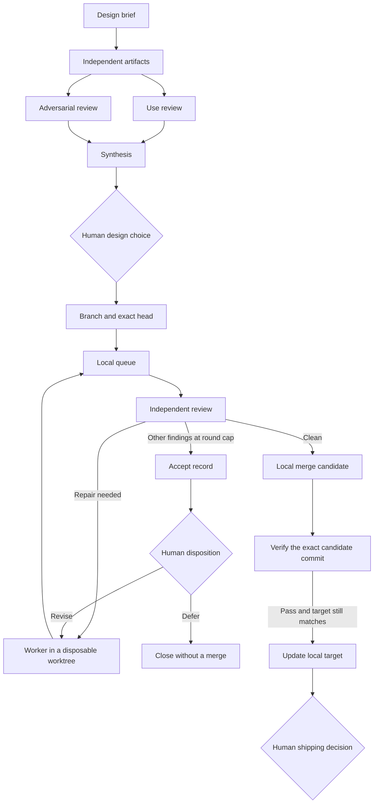

# Architecture

kevin-agent-kit runs a local coordinator for a Git repository. The operator
configures the agent commands and the verification command. The coordinator
moves reviewed work through the loop while the project owner decides which
design to build, when to release, and when to clean up shared resources.

## Review and repair

A queue entry pins a local branch and its commit. The reviewer receives a
lens prompt on stdin and returns a JSON findings report. When repair is needed, a worker gets a
Markdown brief in a disposable detached worktree and commits the correction
there. Keep the source branch free of checkouts during repair so the loop
can advance it safely. Each new head returns to review.

High-risk findings continue through repair beyond the configured round cap.
A lane with only other findings at the cap records the findings and waits
for a human disposition. Revise sends the lane back to a worker. Defer
closes it without merging. Inspect the evidence with `accept-record` and
record the disposition with `decide`. See [operating the loop](loop.md) for
configuration and the command contracts.

## Verification and shipping

The merge train prepares a candidate against the current local target and
runs the configured verification command in the candidate worktree. A
remote CI wrapper can gate that command by waiting for results for the
exact candidate SHA. The loop uses a compare-and-swap ref update so a
verification result cannot advance a target that has moved. Keep the target
branch free of checkouts. The coordinator checkout can stay on a separate
branch.

The target update is local. Follow the project's shipping process when
publishing a release. Use the [hosting adapters](hosting.md) for PR or MR
operations and the [verification guide](../verify/README.md) to attach
running-app evidence. Follow the [worker rules](../agents/worker-rules.md)
and record human decisions and resource ownership in the [ledgers](ledgers.md).
