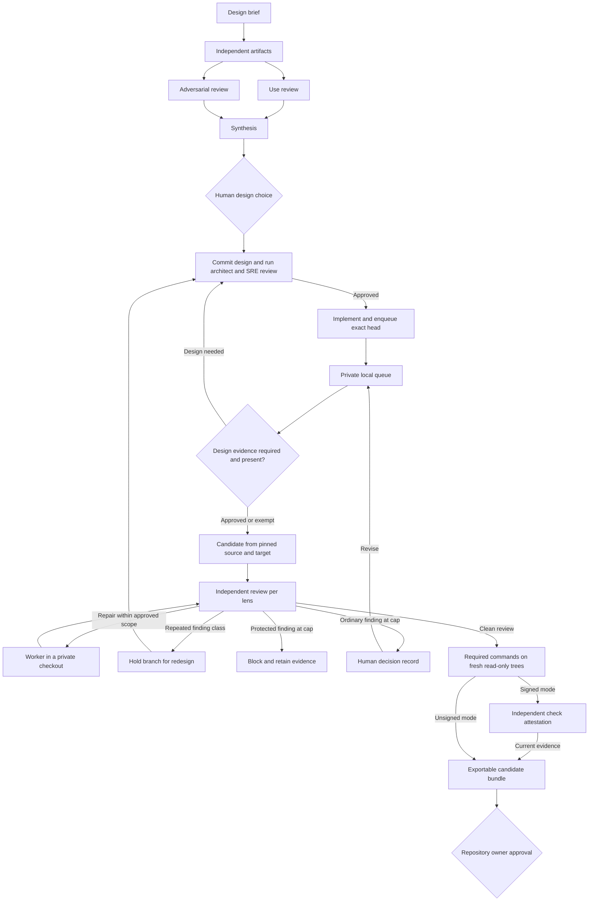

# Architecture

kevin-agent-kit runs a local coordinator for a Git repository. The operator
approves an executable profile outside the checkout. The coordinator prepares
a candidate, and the project owner decides whether to apply and publish it.
See the [signed candidate evidence decision](adr/signed-candidate-evidence.md).
There is no merge train: the kit never updates the target branch. It exports a verified
candidate bundle, and the owner fetches and merges it with the repository's normal workflow.

## Execution and state

Each agent or check runs under a role with its own filesystem, process, and
network namespace. The coordinator owns the state directory and imports only
the approved Git objects into private repositories. Approved scoped repairs
remain in the candidate history. Review and verification of a repair use a
clean checkout of its committed content. Each required command gets a separate read-only
input with a tree ID fixed before execution. The signing adapter receives a scoped
bundle and the direct run evidence. See the [execution contract](design/candidate-execution.md).

The coordinator records the repository, target, source head, merge base,
candidate, policy, and exact execution evidence. A ref or policy change
invalidates the previous result. A human can inspect the evidence and export
the candidate bundle while it is current.

See [operating the loop](loop.md) for profiles and command contracts. Follow the
[worker rules](../agents/worker-rules.md) and use the [ledgers](ledgers.md) for
decisions and resource ownership. The [hosting adapters](hosting.md) and
[screenshot guide](../verify/README.md) cover publishing evidence.
See [observability](observability.md) for queue metrics and rollout objectives.
